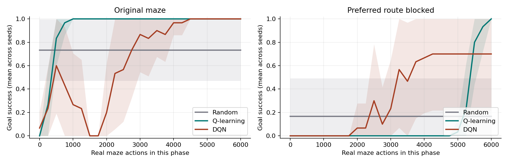

# Hippocampal replay for adaptive navigation

Rutgers CS 525 Neural Computation. This repository starts with Chaitanya's maze environment, conventional reinforcement learning baselines, and route blockage experiment. The team will use these as a reference for its recurrent spiking network and hippocampal replay experiments.



[Baseline report](baseline_report.md) · [Team integration contract](integration.md) · [Rollout data](baseline_evaluation.csv) · [Seed-level summary](baseline_summary.json)

## Run the demo

Tested with Python 3.12 and CPU PyTorch on Linux (x86-64). The requirements file uses the PyTorch CPU wheel index.

```bash
python3.12 -m venv .venv
source .venv/bin/activate
python -m pip install -r requirements.txt
python -m unittest discover -v
python -m experiment --config smoke_config.json --output runs/demo
python -m analysis runs/demo/evaluation.csv --output runs/demo
```

The final command writes `blocked_route_recovery.png` and `summary.json`. The demo runs one seed at a short budget to verify the pipeline. Use the full configuration to reproduce the committed experiment.

```bash
python -m experiment --config blocked_route_config.json --output runs/full
python -m analysis runs/full/evaluation.csv --output runs/full
```

Regenerate the figure directly from the committed rollout data with `python -m analysis baseline_evaluation.csv --output runs/replot`.

## Repository contents

| File | Purpose |
| --- | --- |
| `maze.py` | Versioned corridor, T-maze, and 7 × 7 loop. Stable position IDs, rewards, collision handling, and evaluation-only BFS. |
| `baselines.py` | Random agent, tabular Q-learning, and CPU PyTorch DQN. |
| `experiment.py` | Paired baseline training and frozen evaluation before and after the route changes. |
| `analysis.py` | Rollout aggregation, per-seed recovery summary, and plot generation. |
| `blocked_route_config.json` | Exact experiment configuration for the committed results. |
| `test_maze_and_experiment.py` | Environment, learning, and experiment regression tests. |

The recorded results cover conventional baselines. The CA3-inspired SNN, team replay scheduler, and cue-recall assays are separate teammate deliverables. DQN uses conventional experience replay internally.
