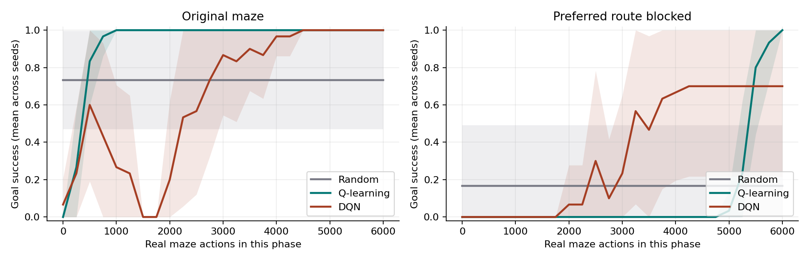

# Hippocampal replay for adaptive navigation
**Baseline and blocked-route study · Chaitanya Manik · Rutgers CS 525**

## Objective

The project asks whether hippocampal-inspired replay helps a spiking agent learn and adapt when a familiar route becomes unavailable. This study establishes conventional navigation performance and defines a common adaptation test for the later spiking comparisons.

## Environment and methods

The virtual agent uses four cardinal moves in a deterministic maze. It receives +1 for reaching the goal, −0.005 for an ordinary move, and −0.05 for a collision, which leaves it in place. Rollouts end on reaching the goal or after 150 actions. A corridor and a T-maze support development. The 7 × 7 experiment map forms a loop between start and goal. Closing cell (row 1, column 3), using zero-based coordinates, changes the shortest route from (1, 1) to the goal from 4 to 12 actions while leaving all evaluation starts connected.

Random actions provide a reference. Tabular Q-learning estimates one value per position and action. DQN uses one-hot position, two 64-unit hidden layers, a uniform transition buffer, and a periodically copied target network. Both learned agents discount by 0.97 and use the same epsilon schedule, from 1.0 to 0.05 during original training, with 0.05 retained after the route change. DQN optimizes every four interactions after collecting 64 transitions. BFS supplies evaluation distances.

Each agent runs for 6,000 original training actions and 6,000 blocked training actions on ten matched seeds. Frozen evaluations at three fixed start cells run every 250 interactions and immediately before training in each phase. Path efficiency divides shortest distance by actual length for successes. Recovery requires success from every start at three consecutive checkpoints. The table reports the median first qualifying checkpoint among recovered seeds. Learning curves show mean success with one standard deviation across seeds, clipped to the plotted range.

## Results

| Agent | Original final success | Blocked initial success | Blocked final success | Seeds meeting recovery criterion | Median actions among recovered seeds |
| --- | ---: | ---: | ---: | ---: | ---: |
| Random | 73.3% | 16.7% | 16.7% | N/A | N/A |
| Q-learning | 100% | 0% | 100% | 6/10 | 5,500 |
| DQN | 100% | 0% | 70% | 7/10 | 3,500 |

Both trained agents failed all 30 evaluation rollouts immediately after the blockage. Q-learning ultimately reached every goal at the last checkpoint. Four of its seeds reached that point too late to demonstrate three consecutive successful checkpoints within budget. DQN met the sustained criterion earlier on the seeds where it recovered, while three seeds remained unsuccessful at the end. Every successful final blocked rollout for the two learned agents used a shortest route. Random evaluation uses a fixed seeded action stream at each checkpoint to give a stable reference. Its relatively high original-maze success reflects the small map and generous action cap.

## Interpretation and limits

This single layout shows that the route change disrupts both learned policies and that recovery speed and final reliability can differ. The comparison is descriptive. The same seed should be the unit of analysis when comparing future replay treatments. The experiment tests conventional RL, and the evidence for hippocampal replay will come from comparing the team's spiking conditions at matched real interaction budgets.

The [configuration](blocked_route_config.json), [4,500 rollout rows](baseline_evaluation.csv), and [seed results](baseline_summary.json) accompany the figure.

## Method reference

- [PyTorch, Reinforcement Learning (DQN) Tutorial](https://docs.pytorch.org/tutorials/intermediate/reinforcement_q_learning.html). Reference for the replay buffer, target network, and optimization structure.
