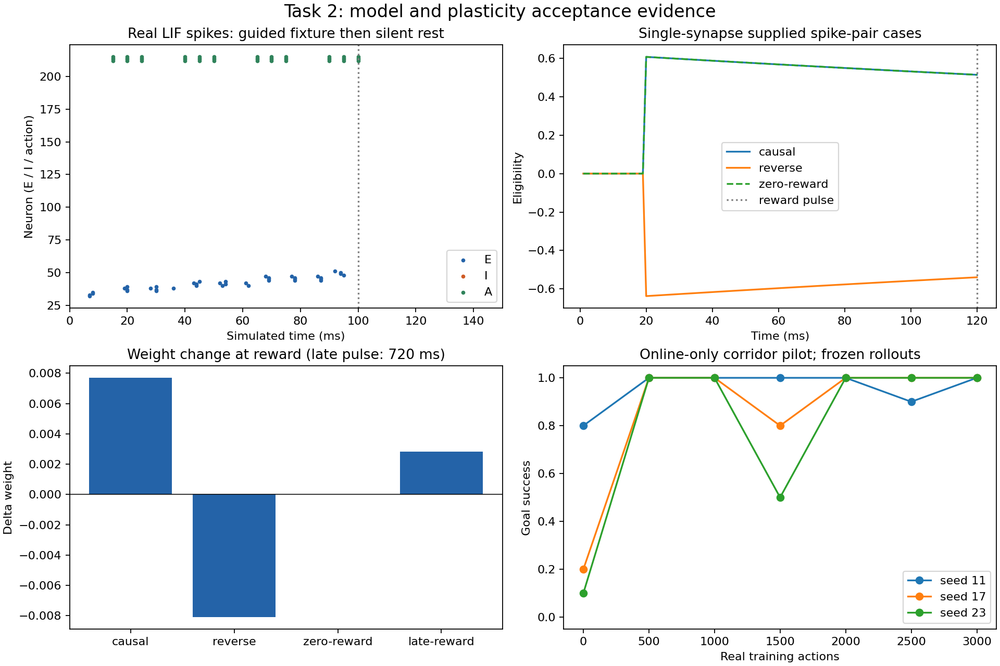

# Spiking model and plasticity — Ketan Singh

Task 2 of the CS 525 parallel implementation plan is implemented in `snn_model.py`. The standalone evidence includes the supplied spike-pair checks, a real LIF spike raster, and an online corridor pilot with seeds 11, 17, and 23. All three seeds achieved 10/10 final frozen successes after 3,000 real training actions each. This is a small navigation pilot; it does not establish replay benefits or autonomous route recall.



## Architecture and simulation

The model receives only an observation ID or externally supplied cue channels. Each observation has four excitatory LIF neurons and the fixed code `4 * observation + local_channel`, with local channel 0–3. Thus the corridor has 84 excitatory neurons and the 7 × 7 loop has 196, including unused wall IDs. There are four global inhibitory LIF neurons and four action pools of four LIF neurons each. Neuron count and codebook remain fixed across original and blocked maps. No map geometry, shortest path, goal location, or expected recall continuation enters the policy.

Recurrent excitatory edges are independently sampled with probability 0.08; self-connections are absent. Initially each recurrent edge has weight 0.12. Every excitatory neuron projects to all action neurons, with initial weight 0.25 times a seeded factor in [0.9, 1.1]. Initialization, exploration, and tie-breaking use a local NumPy generator. Place-drive gain also has fixed seeded heterogeneity in [0.9, 1.1].

One simulation tick is 1 ms. For each population, the normalized membrane update is

```text
v(t+1) = max(0, exp(-1/10) * v(t) + (1-exp(-1/10)) * drive(t)
               + excitatory_jumps(t) - inhibitory_jumps(t))
```

A voltage at least 1 produces a spike and resets to 0. A cell is clamped to 0 for the following two ticks. Synaptic spikes have a one-tick transmission delay; there is no continuous synaptic conductance state. Excitatory spikes drive the inhibitory pool with jump 0.12 per spike, and each inhibitory spike sends a 0.18 negative jump to every excitatory neuron. Inhibition and place-input projections are fixed; recurrent and excitatory-to-action connections are plastic. This is an abstract current-based LIF simulation, not a biophysical reproduction of CA3.

## Action decoding and online updates

`act(observation, training=...)` stimulates the current place population with drive 2.0 for 25 ms and counts each action pool's spikes. The winning pool gives up = 0, down = 1, left = 2, or right = 3; equal counts, including all-zero counts, are broken with the local seeded RNG. Motor voltage and refractory counters reset at each decision. Excitatory and inhibitory state persist within a training episode.

Training uses epsilon exploration, decreasing linearly from 0.8 to 0.1 over 2,000 real training updates and then remaining at 0.1. Evaluation uses no epsilon exploration, though ties remain stochastic. `observe(transition)` must match the preceding training observation and chosen action.

Each observation update adds a 25 ms association interval: 12 ms of current-place input with motor pools silenced, then 13 ms of next-place input with drive 4.0 applied only to the pool for the actual action. This represents an efference copy, including when exploration selected the action. It neither substitutes a preferred action nor uses a planned route. The model learns from the observed next location even on collisions. The recorded reward is applied after the association interval. Decision intervals decay existing traces but do not accumulate new eligibility; association intervals accumulate it.

## Reward-gated STDP and eligibility

The two plastic projections use the same `RewardSTDP` class tested by the single-synapse fixtures. Pre- and post-spike traces decay exponentially with a 20 ms time constant. On a postsynaptic spike an edge gains the previous presynaptic trace; on a presynaptic spike it loses 1.05 times the previous postsynaptic trace. Same-tick spikes do not pair with one another. Eligibility decays with time constant 600 ms and is clipped to [-10, 10].

At each observed reward pulse:

```text
w <- clip(w + 0.015 * reward * eligibility, 0, weight_max)
```

`weight_max` is 0.6 for recurrent edges and 1.0 for action readout edges. No reward means no weight change. Negative observed rewards reverse the signed eligible update; no reward shaping, temporal-difference bootstrap, or value function is used. Traces carry eligibility from preceding actions in the same episode, and both goal arrival and timeout clear them after the final reward. Weights persist across episodes.

The use of separate spike traces, eligibility, and a reward signal follows the three-factor design illustrated by the [Brian2 reward-modulated STDP example](https://brian2.readthedocs.io/en/2.11.0/examples/frompapers.Izhikevich_2007.html). Our discrete reward pulse and normalized LIF network are explicit simplifications of that example's dynamical system.

## Offline and evaluation boundaries

| Method | Behavior |
| --- | --- |
| `begin_episode()` | Clears voltages, refractory counters, spikes, pending action, pair traces, and eligibility; preserves weights, RNG progression, and cumulative counters. |
| `replay(sequence, step_ms=25)` | Resets transient state at snippet entry; presents each recorded current/next observation and actual action for exactly `step_ms`; applies the recorded reward. At least 2 ms per transition is required. Both end flags reset transient state. No maze access or internal buffer exists. |
| `rest(duration_ms)` | Advances zero-input dynamics and trace decay for exactly the duration; does not create eligibility or change weights. |
| `evaluation_copy()` | Makes an independent frozen model with copied weights and RNG and cleared transient state. Training or replay updates on the copy are rejected. |
| `recall(channels, cue_ms, recall_bins, bin_ms, recurrence)` | Runs a fresh frozen copy, presents only the supplied cue, then removes all external input. Returns one decoded location or `None` per subsequent bin. |

For recall, each bin sums spikes over each four-neuron place population. A uniquely maximal, nonzero count decodes a location; silence or a tie returns `None`. Disabling recurrence removes excitatory-to-excitatory transmission during both the cue and the post-cue bins. Cue-induced residual membrane activity can still affect the first bin. The function receives no expected sequence and restores the complete original model implicitly by operating on a separate copy.

The runner already calls `evaluation_copy()` and resets it before rollouts. Direct `act(training=False)` freezes weights but advances that instance's voltage, traces, RNG, and simulation clock; callers must use the snapshot for evaluation during training. The pilot follows this rule. The test suite confirms that changing checkpoint frequency leaves the training model byte-for-byte identical.

## Standalone evidence

The exact constants, source SHA-256 hashes, and runtime are saved in [summary.json](snn_evidence/summary.json). `snn_pilot_config.json` selects the fixed seeds and action budgets; an empty `model` object resolves to the explicitly saved `SNNConfig` defaults.

The supplied pair cases and the extra delayed-reward check produced:

| Case | Pre / post / reward time (ms) | Reward | Measured weight change |
| --- | --- | --- | --- |
| Causal | 10 / 20 / 120 | +1 | +0.00770126 |
| Reversed | 20 / 10 / 120 | +1 | -0.00808632 |
| Zero reward | 10 / 20 / 120 | 0 | 0 |
| Delayed causal | 10 / 20 / 720 | +1 | +0.00283313 |

The delayed-to-early ratio is 0.36787944, matching `exp(-600/600)`. [plasticity_trace.csv](snn_evidence/plasticity_trace.csv) includes every tick. The spike raster in [spikes.csv](snn_evidence/spikes.csv) comes from the real spiking model receiving the fixture's four-transition short route, followed by 50 ms of silent rest. These externally guided spikes are not an autonomous recall result. The terminal transition resets the model at 100 ms, so the rest segment is silent.

The online pilot uses `GridMaze` directly on `corridor-v1`, with the fixed start (1, 1), a 75-action episode limit, and exactly 3,000 real training actions per seed. It uses no replay or offline rest. Ten frozen evaluation rollouts are run at 0, 500, 1,000, 1,500, 2,000, 2,500, and 3,000 actions: 210 evaluations total. Failures remain in every denominator.

| Seed | Initial success | Final success | Final mean actions, all rollouts |
| --- | --- | --- | --- |
| 11 | 8/10 | 10/10 | 14.2 |
| 17 | 2/10 | 10/10 | 16.9 |
| 23 | 1/10 | 10/10 | 12.3 |

Learning was not monotonic: seed 11 scored 9/10 at 2,500 actions, seed 17 scored 8/10 at 1,500, and seed 23 scored 5/10 at 1,500. All these failures are retained in [pilot_evaluation.csv](snn_evidence/pilot_evaluation.csv). [pilot_training_episodes.csv](snn_evidence/pilot_training_episodes.csv) retains unsuccessful episodes and explicitly marks an unfinished episode at the action-budget cutoff. Success at the final checkpoint does not imply optimal routes: the corridor's shortest route takes four actions, considerably fewer than the reported means. These are repeated rollouts of three learned policies, not 30 independent training seeds.

## Stability, validation, and limits

Nonnegative bounded excitatory weights, finite eligibility bounds, refractory periods, and inhibitory feedback limit activity. A 200 ms diffuse-cue check with 40 channels and seed 11 produced 874 excitatory spikes with feedback versus 3,702 without it. This is a controlled circuit diagnostic, not a proof of stability at arbitrary network size or saturation. Global feedback can arrive during refractory time under fully synchronous drive; suppression is not guaranteed for every input. With only four place channels, inhibition can remain subthreshold. Initialization and weight limits are starting parameters rather than fitted biological constants.

The acceptance tests cover the analytic pair response, late reward, zero reward, hard bounds, both plastic projections changing under replay, action teaching, frozen state and RNG isolation, cue removal and recurrence-off transmission, snippet/terminal resets, exact offline time, invalid-input rejection before mutation, and all four modes through the real runner. All 46 repository tests pass, including the 16 new model tests. The existing fixture-regeneration check also passes.

The real-model replay smoke run uses the existing `replay_smoke_config.json`: one seed, 250 original-map actions and 250 blocked-map actions per condition. It completes 72 frozen evaluations, including the immediate blocked-map checkpoint. Each condition gets ten offline sessions and 10,000 ms; each active replay condition gets 400 replayed transitions, while rest gets zero updates. All offline maze-call counts are zero. The [smoke artifacts](snn_evidence/replay_smoke/) retain the configuration, evaluation rows, offline session counts, and sampled replay log. These are interface and accounting checks, not enough data to compare replay performance.

Cue-noise, memory-load, route-similarity, interference/retention, and useful spontaneous sequence completion still require the team's integrated memory assays. No success claim for those capabilities is made here. More seeds, harder mazes, rate diagnostics during prolonged replay, and parameter sensitivity checks are needed for general scientific conclusions.

## Reproduce

From the repository root in a Python environment with NumPy and Matplotlib:

```bash
python -m pip install -r requirements-snn.txt
python -m parallel_fixtures --check
python -m unittest test_snn_model test_parallel_fixtures test_replay -v
python -m snn_diagnostics --config snn_pilot_config.json --output runs/snn_pilot
python -m replay_runner --config replay_smoke_config.json --agent snn_model:make_agent --output runs/snn_replay_smoke
```

To regenerate the committed evidence, use `--output snn_evidence`. Full `python -m unittest discover -v` additionally needs PyTorch for the existing DQN regression. The SNN was tested with Python 3.14.4, NumPy 2.3.5, and Matplotlib 3.10.8 on macOS arm64; full regression used a platform-compatible PyTorch 2.15.0. The baseline's Linux/Python 3.12 dependency pin remains unchanged.
